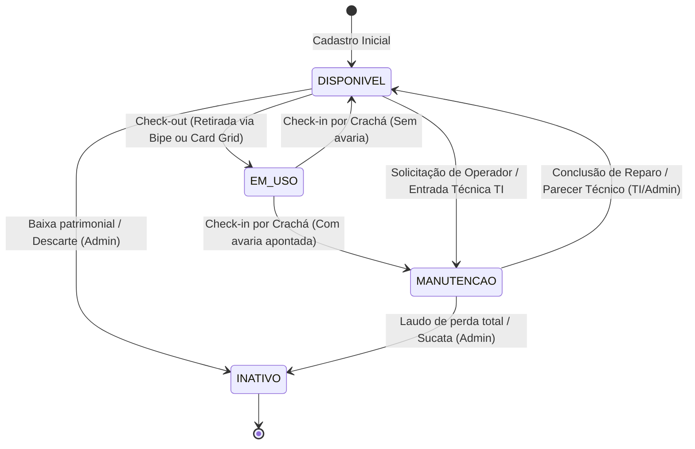
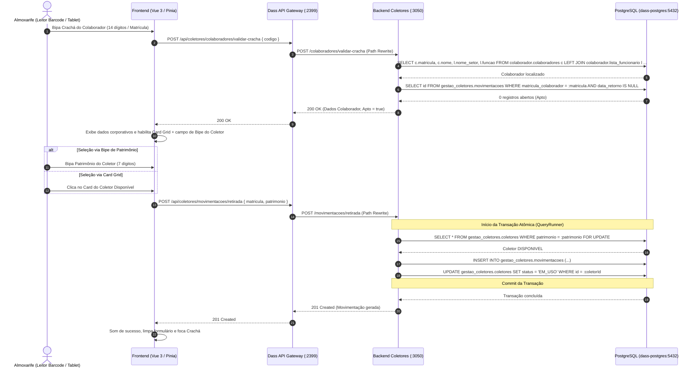
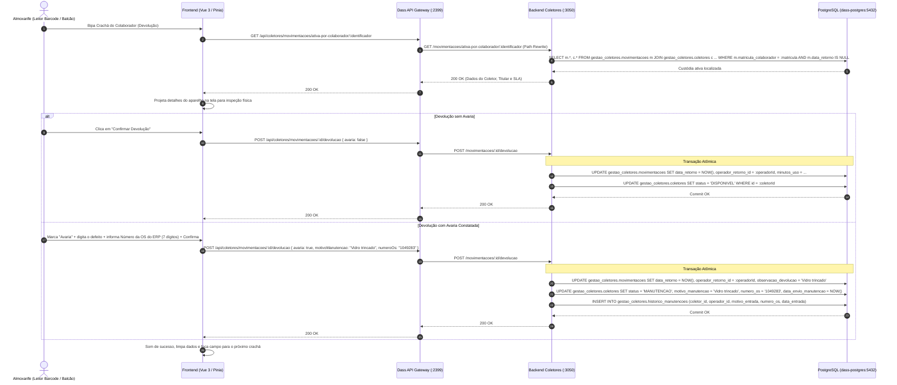
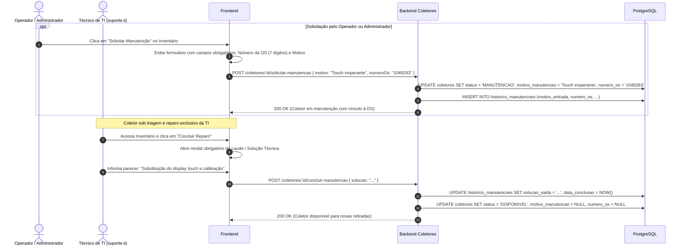

# Fluxos Operacionais e Ciclos de Vida (Ambiente Integrado DASS)

Este documento detalha os fluxos de trabalho da aplicação no ambiente integrado, considerando o **Dass API Gateway**, o **Dass Auth Service**, as tabelas corporativas de colaboradores e o perfil técnico de manutenção.

---

## 1. Ciclo de Vida do Coletor (State Machine)

---

## 2. Fluxo 1: Retirada de Coletor (Check-out Híbrido)

### 2.1 Passos Operacionais
1. O operador está autenticado no sistema e acessa a tela de **Retirada**.
2. **Identificação do Colaborador:**
   - O operador bipa o código de barras no crachá do funcionário (código de 14 dígitos, matrícula de 7 dígitos ou RFID) e pressiona Enter.
   - O backend valida o colaborador no schema `colaborador` e verifica se já possui custódia aberta (`data_retorno IS NULL`).
   - Se possuir pendência: bloqueio imediato com aviso sonoro grave e mensagem visual da custódia aberta.
   - Se apto: projeta os dados corporativos (Nome, Matrícula, Setor, Função) e libera a escolha do coletor.
3. **Seleção do Coletor (Dois Métodos Disponíveis):**
   - **Opção A (Bipe Rápido):** O operador bipa a etiqueta de patrimônio (7 dígitos numéricos).
   - **Opção B (Seleção Visual em Card Grid):** A tela exibe uma grade interativa de cartões com todos os coletores em estoque `DISPONIVEL`, permitindo filtrar por modelo/patrimônio e selecionar com um único toque ou clique.
4. **Efetivação da Custódia:**
   - O backend executa transação ACID com lock pessimista (`pessimistic_write`) no coletor, vincula a custódia ao colaborador e operador de saída, atualizando o status do aparelho para `EM_USO`.
   - Feedback sonoro imediato de sucesso (tom agudo sintetizado).
   - O formulário reseta automaticamente o cursor para o campo de leitura de crachá, pronto para a próxima retirada.

### 2.2 Diagrama de Sequência: Retirada

---

## 3. Fluxo 2: Devolução por Identificação do Colaborador (Check-in)

### 3.1 Passos Operacionais
1. O operador acessa a tela de **Devolução**.
2. O colaborador apresenta seu **Crachá** no balcão e o operador realiza a leitura do código de barras (14 dígitos, matrícula ou RFID).
3. O frontend consulta `GET /api/coletores/movimentacoes/ativa-por-colaborador/:identificador`.
4. O backend localiza a custódia aberta vinculada à matrícula do colaborador (Regra 1:1) e projeta na tela:
   - Aparelho sob custódia (Patrimônio, Marca, Modelo, Serial);
   - Dados do titular (Nome, Matrícula, Setor e Função);
   - Horário de entrega, tempo total de posse e status de SLA (Normal, Alerta ou Excedido).
5. O operador inspeciona o aparelho físico devolvido e conclui:
   - **Devolução Padrão:** Clica em "Confirmar Devolução" -> o coletor retorna para status `DISPONIVEL`.
   - **Devolução com Avaria:** Marca a caixa de seleção "Avaria Constatada", descreve o defeito físico relatado e confirma -> o coletor transita para status `MANUTENCAO`.
6. Transação atômica encerra a movimentação com `data_retorno = NOW()`, operador do recebimento e tempo de posse calculado em minutos.

### 3.2 Diagrama de Sequência: Devolução pelo Colaborador

---

## 4. Fluxo 3: Ciclo de Manutenção & Reparo Técnico

### 4.1 Papéis no Fluxo de Manutenção
* **Operador Comum e Administrador:** Apenas **solicitam manutenção** de coletores em estoque com defeito (`POST /coletores/:id/solicitar-manutencao`), fornecendo motivo e OS de 7 dígitos, ou apontam avaria no momento da devolução.
* **Técnico de TI (`suporte.ti`):** Detém **exclusividade técnica** sobre a manutenção; dá **entrada técnica direta** (`POST /coletores/:id/enviar-manutencao`) e é o **único autorizado a concluir o reparo** com laudo (`POST /coletores/:id/concluir-manutencao`).

---

## 5. Matriz de Tratamento de Exceções

| Cenário de Exceção | Código / HTTP | Reação no Frontend |
| :--- | :--- | :--- |
| **Crachá não localizado no schema `colaborador`** | `404 Not Found` (`COLABORADOR_NAO_ENCONTRADO`) | Tom grave de erro ("beep-error"), flash vermelho na tela, mensagem: "Crachá não localizado na base corporativa da fábrica." |
| **Colaborador com coletor já em posse** | `409 Conflict` (`COLABORADOR_POSSUI_PENDENCIA`) | Alerta em destaque: "Colaborador já possui um coletor em aberto." |
| **Colaborador sem custódia aberta na devolução** | `404 Not Found` (`NENHUMA_CUSTODIA_ABERTA`) | Alerta: "O colaborador não possui nenhum coletor em aberto no momento." |
| **Colaborador com bloqueio preventivo** | `403 Forbidden` (`COLABORADOR_BLOQUEADO`) | Alerta: "Retirada bloqueada para este colaborador: [Motivo registrado pelo almoxarifado]." |
| **Patrimônio fora do padrão de 7 dígitos** | `400 Bad Request` (`FORMATO_PATRIMONIO_INVALIDO`) | Validação instantânea antes de enviar ao backend; campo fica vermelho com foco mantido. |
| **Coletor indisponível / em uso** | `409 Conflict` (`COLETOR_EM_USO`) | Alerta: "Coletor indisponível para retirada." |
| **Operador comum tentando dar baixa técnica** | `403 Forbidden` (`ACESSO_NEGADO_TI`) | Ação desabilitada na interface; bloqueio no backend caso tentada chamada direta. |
| **Tentativa de TI cadastrar outro TI ou Admin** | `403 Forbidden` (`PERMISSAO_NEGADA_TI`) | Modal de cadastro bloqueia a seleção de papéis superiores; backend recusa com erro 403. |
| **Sessão expirada** | `401 Unauthorized` (`AUTH_SESSION_EXPIRED`) | Redirecionamento automático e suave para a tela de autenticação. |
